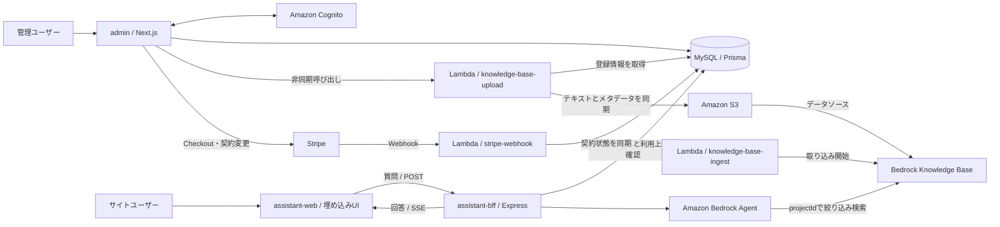
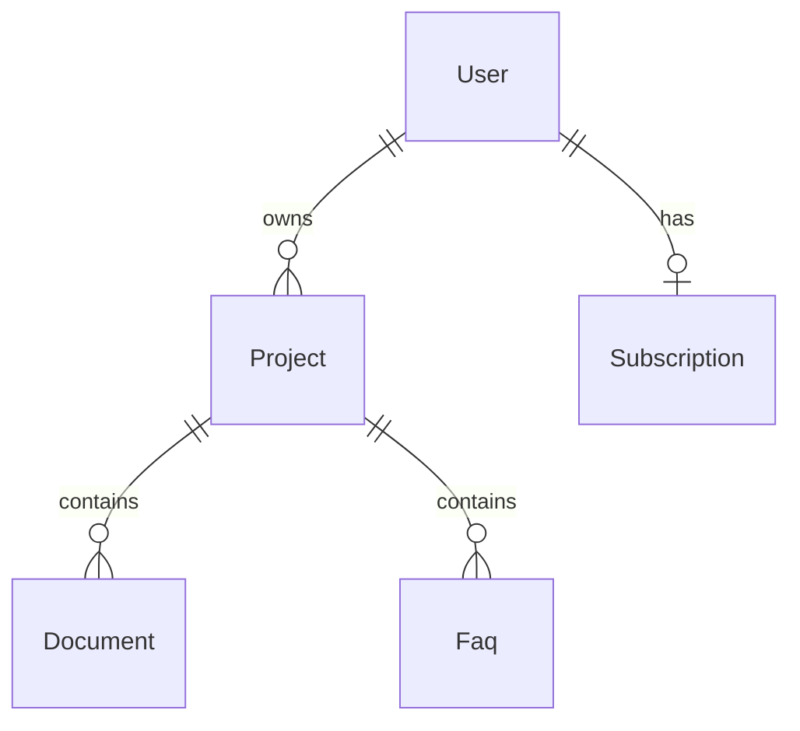

# Ask AI

**Webサイトの運営者が、自社の情報に基づいて回答するAIアシスタントを設置できるサービスです。**

管理画面でドキュメントやFAQを登録し、発行されたHTMLタグをWebサイトに貼り付けることで、訪問者向けのチャットを導入できます。回答生成にはAmazon Bedrock AgentとKnowledge Basesを利用し、登録した情報を検索して回答に用いるRAG（Retrieval-Augmented Generation：検索拡張生成）を組み込んでいます。

このリポジトリには、管理画面、埋め込み用チャットUI、チャットAPI、ナレッジ同期・課金連携のLambda関数、共通のデータベース定義、サービス紹介ページを収めています。TypeScriptを中心としたnpm workspacesのモノレポで、フロントエンドから外部サービス連携までを扱います。

## 目次

- [目的と利用イメージ](#目的と利用イメージ)
- [主な機能](#主な機能)
- [システム構成とデータの流れ](#システム構成とデータの流れ)
- [Workspaceの役割](#workspaceの役割)
- [使用技術](#使用技術)
- [設計と実装のポイント](#設計と実装のポイント)
- [データモデル](#データモデル)
- [ファイル構成](#ファイル構成)
- [開発環境と起動方法](#開発環境と起動方法)
- [品質管理](#品質管理)
- [ビルドと運用向けの構成](#ビルドと運用向けの構成)
- [実装を読む際の入口](#実装を読む際の入口)

## 目的と利用イメージ

Webサイトには、サービス説明、利用方法、よくある質問など、訪問者が知りたい情報が複数の場所に分散しています。Ask AIは、それらを運営者がナレッジとして登録し、訪問者が自然言語で質問できる窓口を提供することを目的としています。

運営者はチャット画面やAIとの通信処理を個別に開発する必要がなく、管理画面での情報登録とHTMLタグの設置を通じて導入できます。また、Webサイトを「プロジェクト」として分けることで、一つのアカウントから複数サイトの情報を管理できます。

| 用語           | 意味                                                                   |
| -------------- | ---------------------------------------------------------------------- |
| 管理ユーザー   | AIアシスタントを設置するWebサイトの運営者                              |
| サイトユーザー | 設置先のWebサイトを訪問し、アシスタントに質問する人                    |
| プロジェクト   | Webサイトごとの管理単位。ドキュメント・FAQ・チャット利用回数を保持する |
| ドキュメント   | AIが参照する単一のテキスト。管理用タイトルと本文を持つ                 |
| FAQ            | AIが参照する質問と回答のペア                                           |
| ナレッジベース | 登録情報を検索可能な状態にした、AIの回答用の情報源                     |

### 利用の流れ

1. 管理ユーザーがアカウントを作成し、管理画面にログインする。
2. 対象のWebサイト用にプロジェクトを作成する。
3. サービス説明などのドキュメントと、質問・回答形式のFAQを登録する。
4. ナレッジベースへの反映を実行し、AIが参照する情報を更新する。
5. 管理画面に表示されるカスタム要素と読み込み用スクリプトをWebサイトに設置する。
6. サイトユーザーがチャットで質問し、そのプロジェクトの情報を踏まえた回答を受け取る。

埋め込み用HTMLは次の形式です。`YOUR_PROJECT_ID`は管理画面で作成したプロジェクトのIDに置き換えます。スクリプトURLは現在の管理画面で生成しているものです。

```html
<ask-ai-assistant project-id="YOUR_PROJECT_ID"></ask-ai-assistant>

<script
  type="module"
  src="https://assistant-web.ask-ai.cognova-ai.com/ask-ai-assistant.js"
></script>
```

## 主な機能

| 対象           | 機能                 | 実装内容                                                                 |
| -------------- | -------------------- | ------------------------------------------------------------------------ |
| 管理ユーザー   | 認証・アカウント管理 | サインアップ、確認コードによる登録確認、ログイン、パスワード再設定・変更 |
| 管理ユーザー   | プロジェクト管理     | 複数プロジェクトの作成・選択・名称変更、ドキュメント・FAQ件数の表示      |
| 管理ユーザー   | ナレッジ管理         | ドキュメント・FAQの登録・編集・論理削除                                  |
| 管理ユーザー   | ナレッジの反映       | Lambdaの非同期呼び出しによるS3への同期、最終反映日時の表示               |
| 管理ユーザー   | ウィジェット設置     | プロジェクトに対応するHTMLタグの表示・コピー                             |
| 管理ユーザー   | 契約管理             | Stripe Checkoutによる有料プラン登録、契約期間末の解約予約・予約取消      |
| サイトユーザー | チャット             | ウィジェットの開閉、質問送信、回答チャンクの逐次表示、通信エラーの表示   |
| システム       | 利用制限             | 契約状態に応じた登録件数・チャット利用回数の制限                         |
| サービス紹介   | ランディングページ   | 機能紹介、導入方法、料金案内、埋め込みデモ、各種ポリシーの掲載           |

現行実装では、無料プランのドキュメント・FAQ登録上限は、1プロジェクトあたりそれぞれ5件です。チャットの上限はプロジェクトごとの累計で、無料プランは100回、サブスクリプションが`active`の場合は1,000回です。月ごとに回数をリセットする実装ではありません。

## システム構成とデータの流れ



図はアプリケーションと外部サービスの論理的な関係を示しています。AWSリソースの作成やトリガーの設定は別途必要です。

### ナレッジを反映する流れ

1. 管理画面のServer Actionで認証・プロジェクトの所有者を確認し、アップロード用Lambdaを非同期で呼び出します。
2. LambdaがMySQLから有効なドキュメント・FAQを取得します。
3. S3の`{projectId}/documents/`、`{projectId}/faqs/`にテキストを同期し、各ファイルに`projectId`を含むメタデータファイルを付けます。
4. 取り込み用LambdaがBedrock Knowledge Baseのインジェスチョンジョブを開始し、S3上の情報を検索対象に取り込みます。

S3への同期とKnowledge Baseへの取り込みは別々のLambda関数です。アップロード用Lambdaから取り込み用Lambdaを直接呼び出す処理は含まれていないため、両者をつなぐ実行タイミングやトリガーはAWS側で構成する必要があります。また、管理画面の最終反映日時はS3への同期完了時に更新され、Knowledge Baseの取り込み完了を示すものではありません。

### 質問に回答する流れ

1. ウィジェットが会話セッション用のUUIDを生成し、`POST /chat/:sessionId`に`projectId`と`inputMessage`を送ります。
2. BFFがZodで入力を検証し、プロジェクトの存在・契約状態・利用上限を確認して、チャット回数を加算します。
3. BFFがBedrock Agentを呼び出します。このときKnowledge Baseの検索条件に`projectId`を渡し、対象プロジェクトの情報に絞ります。
4. BFFが回答をSSE（Server-Sent Events）で配信し、ウィジェットが受け取ったチャンクを画面に追加します。

SSEでは`output-message`で回答チャンク、`done`で完了、`app-error`でストリーム開始後のエラーを通知します。同じセッションIDを継続して送ることで、Bedrock Agentに会話の文脈を引き継ぎます。

## Workspaceの役割

ルートの`package.json`で`apps/*`と`packages/*`をWorkspaceとして管理しています。

| Workspace                 | ディレクトリ                               | 責務                                             | 主な技術                                |
| ------------------------- | ------------------------------------------ | ------------------------------------------------ | --------------------------------------- |
| `@internal/admin`         | [`apps/admin`](apps/admin)                 | 管理ユーザー向けの管理画面とサーバー処理         | Next.js、React、Amplify、Stripe         |
| `@internal/assistant-web` | [`apps/assistant-web`](apps/assistant-web) | 外部サイトに埋め込むチャットUI                   | React、Vite、Web Components、Shadow DOM |
| `@internal/assistant-bff` | [`apps/assistant-bff`](apps/assistant-bff) | チャットUI向けのAPIとAI連携                      | Express、Bedrock Agent Runtime、SSE     |
| `@internal/functions`     | [`apps/functions`](apps/functions)         | ナレッジ同期・取り込み・課金イベントの処理       | AWS Lambda、S3、Bedrock、Stripe         |
| `@internal/marketing`     | [`apps/marketing`](apps/marketing)         | サービス紹介・導入案内の静的ページ               | HTML、CSS、JavaScript                   |
| `@internal/rdb`           | [`packages/rdb`](packages/rdb)             | DBスキーマ、マイグレーション、共通DBクライアント | Prisma、MySQL、Secrets Manager          |

### `apps/admin`：管理画面

Next.js App Routerを利用し、Server Componentsでのデータ取得とServer Actionsでの更新処理を組み合わせています。認証にはAmazon Cognitoを使い、AWS AmplifyとNext.js向けアダプターを通じてブラウザ・サーバーの両方で認証状態を扱います。

`src/app`はルーティングとレイアウトを担当し、画面や業務ロジックは`src/features`に配置しています。ルートグループで、公開ページ、認証後のユーザー作成ページ、ユーザー登録済みのページ、プロジェクト選択後のページを整理しています。

フォームはReact Hook FormとZodで管理し、UIにはshadcn/ui・Radix UI・Tailwind CSSを使用しています。サーバー処理では、入力の再検証、ログインユーザーの取得、プロジェクトの所有者確認、対象データとプロジェクトの対応確認を行います。

### `apps/assistant-web`：埋め込みチャットUI

React製のUIをWeb Componentsのカスタム要素`<ask-ai-assistant>`として公開します。設置先のサイトはReactを採用している必要がなく、HTMLタグとES Moduleの読み込みで利用できます。

カスタム要素の内部にShadow DOMを作成し、CSSとReactの描画先を配置しています。これにより、設置先のスタイルとウィジェットのスタイルが相互に干渉しにくい構造にしています。要素がDOMから外れた際にはReactのルートもアンマウントします。

Viteのライブラリモードで配布用の`ask-ai-assistant.js`を生成します。`project-id`属性で対象プロジェクトを指定し、任意の`z-index`属性で表示の重なり順を調整できます。

### `apps/assistant-bff`：チャットAPI

BFF（Backend for Frontend）として、チャットUIとBedrock Agentの間を仲介するExpressアプリケーションです。ブラウザにAWSの認証情報を渡さず、サーバー側でDBへのアクセス、利用制限の判定、AIへの問い合わせを行います。

`src/bootstrap`に起動処理と共通エラーハンドリング、`src/features/chat`にルーティング・入力検証・Bedrock呼び出し・SSE配信を配置しています。`GET /health`も用意しています。

### `apps/functions`：非同期処理とWebhook

次の3種類のLambdaハンドラーを実装しています。

| 関数                    | 役割                                                                                                                  |
| ----------------------- | --------------------------------------------------------------------------------------------------------------------- |
| `knowledge-base-upload` | ドキュメント・FAQをS3へ差分同期。削除済みデータに対応するS3オブジェクトの削除、同期中フラグ・最終同期日時の更新も行う |
| `knowledge-base-ingest` | Bedrock Knowledge Baseのインジェスチョンジョブを開始する                                                              |
| `stripe-webhook`        | Lambda Function URLでStripeのイベントを受信し、署名検証後に契約情報をDBへ同期する                                     |

Stripe Webhookは`checkout.session.completed`、`customer.subscription.updated`、`customer.subscription.deleted`を処理します。画面からの契約操作と、外部サービスから届く契約状態の通知を分けて扱っています。

### `apps/marketing`：サービス紹介ページ

プレーンなHTML・CSS・JavaScriptで構成したランディングページです。サービス紹介、導入手順、料金案内、チャットウィジェットのデモ、利用規約などを`src/index.html`にまとめています。開発時は`serve`で静的配信します。

### `packages/rdb`：共通データアクセス

Prismaスキーマとマイグレーション履歴、生成クライアント、DB接続の初期化処理を管理します。`admin`・`assistant-bff`・`functions`がこのWorkspaceを参照し、共通の型とDBクライアントを利用します。

MySQLへの接続には`@prisma/adapter-mariadb`を使用しています。DBのユーザー名・パスワードはAWS Secrets Managerから取得し、`DATABASE_URL`の接続先情報と組み合わせます。開発時はPrisma Clientを`globalThis`上に保持し、モジュール再読み込み時に再利用します。

## 使用技術

バージョンはこのリポジトリの`package.json`に記載されたものです。

| 分類                   | 技術                                                           | 用途                                                               |
| ---------------------- | -------------------------------------------------------------- | ------------------------------------------------------------------ |
| 言語・実行環境         | TypeScript 5.9、Node.js 24                                     | アプリケーションとサーバー処理の実装。VoltaでNode.js 24.13.1を指定 |
| モノレポ               | npm workspaces                                                 | Workspace間の依存管理と共通コマンドの実行                          |
| 管理画面               | Next.js 16.2、React 19.2                                       | App Router、Server Components、Server Actions                      |
| 埋め込みUI             | React 19.2、Vite 8、Web Components                             | 配布スクリプトのビルド、カスタム要素・Shadow DOMによる埋め込み     |
| UI・スタイル           | Tailwind CSS 4.2、shadcn/ui、Radix UI、Lucide                  | 管理画面・チャットUIの構築                                         |
| Reactの最適化          | React Compiler                                                 | 管理画面と埋め込みUIのビルドに組み込み                             |
| フォーム・検証         | React Hook Form 7、Zod 4                                       | フォーム状態管理、入力・外部データの実行時検証                     |
| API                    | Express 5.2、cors                                              | チャットAPI、ヘルスチェック、共通エラーハンドリング                |
| 回答配信               | SSE、`@microsoft/fetch-event-source`                           | POSTリクエストに対するイベントストリームの受信と逐次表示           |
| 認証                   | Amazon Cognito、AWS Amplify 6                                  | 管理ユーザーの認証とNext.jsサーバー側でのセッション取得            |
| AI・RAG                | Amazon Bedrock Agent、Knowledge Bases                          | 会話セッション、登録情報の検索、回答生成                           |
| DB                     | MySQL 8.4、Prisma 7.7                                          | 業務データの永続化、型付きクエリ、マイグレーション                 |
| 非同期処理・ストレージ | AWS Lambda、Amazon S3、AWS SDK v3                              | ナレッジ同期、取り込みジョブ開始、Webhook受信                      |
| シークレット管理       | AWS Secrets Manager                                            | DB接続認証情報の取得                                               |
| 課金                   | Stripe SDK 22                                                  | Checkout、サブスクリプション操作、Webhookの署名検証                |
| ログ                   | Winston 3                                                      | サーバー処理のログ出力                                             |
| 品質管理               | ESLint 9、Prettier 3、Vitest 4、Husky、lint-staged、commitlint | 静的解析、整形、テスト実行環境、コミット時のチェック               |
| コンテナ・運用補助     | Docker、Amazon ECR、AWS Systems Manager                        | イメージ作成・送信、RDSへのポートフォワーディング                  |

## 設計と実装のポイント

### 1. 利用者と実行形態に応じた責務の分離

管理ユーザー向けのNext.jsアプリ、外部サイトに配布するウィジェット、公開チャットAPI、Lambdaによるバックグラウンド処理を別Workspaceに分けています。DB定義は共通パッケージに集約し、実行環境が異なるアプリケーションから同じモデルを利用します。

### 2. プロジェクト単位でのデータ管理と検索範囲の制御

管理画面では認証に加えてプロジェクトの所有者を確認します。RAGでは、S3上のメタデータに付与した`projectId`とBedrockへの検索フィルターを対応させ、質問対象のプロジェクトの情報を検索します。

実装例：[管理画面の更新処理](apps/admin/src/features/documents/components/document-update-page/actions.ts)、[S3メタデータの生成](apps/functions/src/functions/knowledge-base-upload/documents.ts)、[Bedrock検索フィルター](apps/assistant-bff/src/features/chat/bedrock-client.ts)。

### 3. 外部サイトへの組み込みを前提としたUI

Web Componentsを公開インターフェースにすることで、設置先のフロントエンド技術への依存を抑えています。Shadow DOMによるスタイルの分離と、要素の接続・切断に対応したReactのライフサイクル管理を組み合わせています。

実装例：[カスタム要素](apps/assistant-web/src/features/assistant/assistant-element.tsx)。

### 4. ストリームに合わせた通信・画面状態の管理

BFFがBedrockの回答チャンクをSSEイベントに変換し、フロントエンドが受信中・完了・エラーのメッセージ状態を管理します。共通エラーハンドラーは、HTTPヘッダー送信前とストリーム開始後でエラーの返し方を分けています。

実装例：[SSE配信](apps/assistant-bff/src/features/chat/sse.ts)、[チャット状態管理](apps/assistant-web/src/features/assistant/components/assistant/chat/chat-provider/provider.tsx)、[共通エラーハンドラー](apps/assistant-bff/src/bootstrap/error-handler.ts)。

### 5. ナレッジ同期の差分処理と重複実行への対処

DBの更新日時とS3オブジェクトの最終更新日時を比較し、変更がない情報の再アップロードを省きます。DBで論理削除された情報はS3からも削除します。また、プロジェクトの同期中フラグを条件付き更新し、すでに同期中であれば処理を終了します。

実装例：[同期ハンドラー](apps/functions/src/functions/knowledge-base-upload/index.ts)、[ドキュメントの差分同期](apps/functions/src/functions/knowledge-base-upload/documents.ts)。

### 6. 型検査と実行時検証の併用

TypeScriptの`strict`に加え、`noUncheckedIndexedAccess`や`exactOptionalPropertyTypes`などを有効にしています。コンパイル時の型だけでなく、フォーム、APIリクエスト、Lambdaイベント、Secrets Managerの取得結果などの境界でZodによる検証も行います。

実装例：[チャットAPIの検証](apps/assistant-bff/src/features/chat/post-chat-handler.ts)、[DB認証情報の検証](packages/rdb/src/index.ts)。

## データモデル

スキーマの定義は[`packages/rdb/prisma/schema.prisma`](packages/rdb/prisma/schema.prisma)、変更履歴は[`packages/rdb/prisma/migrations`](packages/rdb/prisma/migrations)にあります。



| モデル         | 主なデータ・責務                                                              |
| -------------- | ----------------------------------------------------------------------------- |
| `User`         | CognitoユーザーID、Stripe顧客ID、保有プロジェクト、契約への関連               |
| `Subscription` | Stripe契約ID、契約状態、契約期間、期間末解約の予約状態。ユーザーごとに最大1件 |
| `Project`      | 所有ユーザー、名称、ナレッジ同期状態・日時、累計チャット回数                  |
| `Document`     | プロジェクト、管理用タイトル、AIが参照する本文                                |
| `Faq`          | プロジェクト、質問文、回答文                                                  |

`User`・`Project`・`Document`・`Faq`には`deletedAt`を設けています。ドキュメントとFAQの削除操作ではレコードを残して論理削除し、一覧取得やナレッジ同期から除外します。Documentのタイトルは管理画面で識別するための情報で、S3への同期対象は本文です。

## ファイル構成

主要なディレクトリとファイルを抜粋しています。生成物・依存パッケージは省略しています。

```text
ask-ai/
├── apps/
│   ├── admin/
│   │   ├── src/
│   │   │   ├── app/                  # App Routerのルート・レイアウト
│   │   │   ├── components/ui/        # 共通UI部品（shadcn/ui）
│   │   │   ├── features/             # 機能単位の画面・Server Actions
│   │   │   │   ├── auth/             # Cognito / Amplify認証
│   │   │   │   ├── billing/          # Stripe契約管理・プラン判定
│   │   │   │   ├── documents/        # ドキュメント管理
│   │   │   │   ├── embed-snippet/    # 埋め込みタグ発行
│   │   │   │   ├── faqs/             # FAQ管理
│   │   │   │   ├── knowledge-base/   # ナレッジ反映操作
│   │   │   │   ├── layouts/          # 管理画面レイアウト
│   │   │   │   ├── projects/         # プロジェクト管理
│   │   │   │   ├── theme/            # テーマ切り替え
│   │   │   │   └── users/            # ユーザー作成・パスワード変更
│   │   │   ├── hooks/                # 共通フック
│   │   │   └── lib/                  # ログ・日時・UI補助
│   │   ├── next.config.mts
│   │   └── Dockerfile
│   ├── assistant-web/
│   │   ├── src/
│   │   │   ├── features/assistant/   # カスタム要素・チャットUI・状態管理
│   │   │   ├── pages/dev-example/    # 開発用の埋め込みサンプル
│   │   │   ├── scripts/              # 配布スクリプトのエントリーポイント
│   │   │   ├── lib/
│   │   │   └── types/
│   │   ├── public/static-example.html
│   │   └── vite.config.ts
│   ├── assistant-bff/
│   │   ├── src/
│   │   │   ├── bootstrap/           # Express起動・共通エラー処理
│   │   │   ├── features/chat/       # API・Bedrock連携・SSE
│   │   │   └── lib/                 # HTTPエラー型・ログ
│   │   └── Dockerfile
│   ├── functions/
│   │   ├── src/
│   │   │   ├── functions/
│   │   │   │   ├── knowledge-base-upload/
│   │   │   │   ├── knowledge-base-ingest/
│   │   │   │   └── stripe-webhook/
│   │   │   ├── lib/logger/
│   │   │   └── index.ts             # ローカル動作確認用エントリーポイント
│   │   └── Dockerfile
│   └── marketing/
│       └── src/index.html           # ランディングページ
├── packages/
│   └── rdb/
│       ├── prisma/
│       │   ├── schema.prisma        # データモデル
│       │   └── migrations/          # DB変更履歴
│       ├── src/index.ts             # Prisma Client・Secrets Manager連携
│       └── prisma.config.mts        # Prisma CLIの接続設定
├── scripts/                         # ECR送信・DB接続などの運用補助
├── .husky/                          # コミット時のフック
├── package.json                     # Workspace・共通スクリプト・Node指定
├── package-lock.json
├── tsconfig.json
├── eslint.config.ts
├── prettier.config.ts
├── lint-staged.config.ts
└── commitlint.config.ts
```

## 開発環境と起動方法

コマンドはすべてリポジトリのルートから実行します。

### 前提条件

- Node.js 24系とnpm。Volta利用時は`package.json`の指定で24.13.1を利用できます。
- MySQL 8.4への接続環境。
- 各処理で利用するAWSリソースと認証情報。DB接続にはSecrets Managerへのアクセスも必要です。
- 課金機能を利用する場合はStripeのキー・Price・Webhook設定。

このリポジトリは外部サービスを利用する構成です。AWS環境一式を作成するIaCや、外部サービスを置き換えるローカルモックは含まれていません。

### 依存パッケージとDBクライアントの準備

```bash
npm ci

# 必要な環境変数を設定したうえで実行
npx -w @internal/rdb prisma generate
npm run build -w @internal/rdb
```

`admin`・`assistant-bff`・`functions`は`@internal/rdb`のビルド成果物を参照します。Prismaスキーマを変更した場合も、クライアント生成と共通パッケージのビルドを行います。

### 環境変数

各Workspaceの`.env`またはプロセスの環境変数に、利用する処理に必要な値を設定します。`.env`はGitの管理対象外です。以下は変数名と用途のみを示しており、実際の設定値は含めていません。

| 対象                           | 変数                                                 | 用途                                                                      |
| ------------------------------ | ---------------------------------------------------- | ------------------------------------------------------------------------- |
| DBを利用するアプリ・Prisma CLI | `DATABASE_URL`                                       | DBのホスト・ポート・データベース名を含む接続URL                           |
| DBを利用するアプリ・Prisma CLI | `DATABASE_CREDENTIALS_SECRET`                        | `username`・`password`を保持するSecrets Managerのシークレット識別子       |
| AWS SDKを利用する処理          | `AWS_REGION`など                                     | AWS SDKの接続設定。認証情報は実行環境のIAMロールやローカルのAWS設定で供給 |
| `admin`                        | `NEXT_PUBLIC_USER_POOL_ID`                           | Cognito User Pool ID                                                      |
| `admin`                        | `NEXT_PUBLIC_USER_POOL_CLIENT_ID`                    | Cognito User Pool Client ID                                               |
| `admin`                        | `APP_URL`                                            | Stripe Checkout完了・キャンセル後の戻り先の基準URL                        |
| `admin`                        | `STRIPE_SECRET_KEY`、`STRIPE_PRICE_ID`               | Stripe APIキーと契約対象のPrice ID                                        |
| `assistant-web`                | `VITE_BFF_BASE_URL`                                  | チャットAPIの基準URL。Viteのビルド時に埋め込まれる                        |
| `functions`のアップロード処理  | `KNOWLEDGE_BASE_S3_BUCKET`                           | ナレッジの同期先S3バケット                                                |
| `functions`の取り込み処理      | `KNOWLEDGE_BASE_ID`、`KNOWLEDGE_BASE_DATA_SOURCE_ID` | 取り込み対象のKnowledge Baseとデータソース                                |
| `functions`のWebhook処理       | `STRIPE_SECRET_KEY`、`STRIPE_WEBHOOK_SECRET`         | Stripe APIキーとWebhook署名検証用シークレット                             |

Prisma CLI用の設定は`packages/rdb/.env`などで用意し、アプリの起動時にもDB接続用の変数を渡します。現在の接続処理は、`DATABASE_URL`内に書いた認証情報を使う構成ではなく、Secrets Managerから取得した値でユーザー名・パスワードを設定します。

一部の接続先は現時点でソースコードに定義しています。別環境で動かす際は、次の設定も確認してください。

- BFFのBedrock Agent ID・Alias ID・Knowledge Base ID：[`bedrock-client.ts`](apps/assistant-bff/src/features/chat/bedrock-client.ts)
- 管理画面が呼び出すLambda名：[`knowledge-base-upload-page/actions.ts`](apps/admin/src/features/knowledge-base/components/knowledge-base-upload-page/actions.ts)
- 管理画面が生成するウィジェットの配信URL：[`embed-snippet-page/index.tsx`](apps/admin/src/features/embed-snippet/components/embed-snippet-page/index.tsx)
- Bedrockとナレッジ用S3のクライアントは`us-east-1`を明示指定。

### 開発サーバー

管理画面とBFFは、標準設定では両方ともポート3000を使用します。同時起動する場合は、例えば管理画面を3001に変更します。以下はそれぞれ別のターミナルで実行します。

```bash
# 管理画面：http://localhost:3001
npm run dev -w @internal/admin -- --port 3001

# チャットAPI：http://localhost:3000
npm run dev -w @internal/assistant-bff

# 埋め込みUI：URLはViteの起動ログを参照
npm run dev -w @internal/assistant-web

# サービス紹介ページ：URLはserveの起動ログを参照
npm run dev -w @internal/marketing
```

ローカルのウィジェットには`VITE_BFF_BASE_URL=http://localhost:3000`を設定します。Viteの開発サーバーで`/src/pages/dev-example/index.html`を開くと埋め込みUIを確認できます。サンプル内の`project-id`は、接続するDBに存在するプロジェクトに変更してください。管理画面の`APP_URL`も、上記例では`http://localhost:3001`に合わせます。

`functions`の`dev`はHTTPサーバーではなく、`src/index.ts`からアップロード・取り込みハンドラーを実行する動作確認用コマンドです。実際に外部サービスを操作するため、利用時はコード内のプロジェクトIDと接続先を確認します。

### DB関連コマンド

```bash
# 接続先DBに既存マイグレーションを適用
npx -w @internal/rdb prisma migrate deploy

# 開発時にスキーマ変更をマイグレーションとして作成・適用
npx -w @internal/rdb prisma migrate dev

# DBを確認するためのGUIを起動
npx -w @internal/rdb prisma studio
```

いずれもDB接続設定とSecrets Managerへのアクセスが必要です。既存AWS環境のRDSへ接続するためのSSMポートフォワーディング用スクリプトも[`scripts/rdb-port-forward.sh`](scripts/rdb-port-forward.sh)にあります。

## 品質管理

| 仕組み              | 内容                                                        |
| ------------------- | ----------------------------------------------------------- |
| TypeScript          | 各TypeScript Workspaceで厳格な型検査を実行                  |
| ESLint / Prettier   | 共通設定とWorkspaceごとの設定でコード解析・整形             |
| Prisma              | スキーマ検証・フォーマット・マイグレーション履歴の管理      |
| Husky / lint-staged | コミット時にステージ済みファイルへESLint・Prettierを適用    |
| commitlint          | Conventional Commits形式のコミットメッセージを検証          |
| Vitest              | 管理画面・ウィジェット・BFF・Lambda用のテスト実行環境を設定 |

```bash
# 全Workspaceのチェック
npm run lint:check
npm test

# TypeScript Workspaceの型検査のみ実行
npm run test:typecheck --workspaces --if-present

# 特定Workspaceのチェック
npm run lint:check -w @internal/admin
npm run test:typecheck -w @internal/assistant-bff

# ESLint・Prettierなどによる自動修正
npm run lint:fix
```

現時点では、Vitestの設定はありますが、テストケースは配置されていません。`passWithNoTests: true`によりテストがない場合も成功する設定です。`npm test`には型検査も含まれますが、その成功は自動テストによる機能検証を意味しません。`marketing`の`test`は何もしないスクリプトです。また、RDBの`lint:check`にはPrismaの設定読み込みが含まれるため、DB接続用環境変数を設定している場合はSecrets Managerへのアクセスも発生します。

## ビルドと運用向けの構成

```bash
# 共通DBパッケージを先に準備
npx -w @internal/rdb prisma generate
npm run build -w @internal/rdb

# 各アプリケーションのビルド
npm run build -w @internal/admin
npm run build -w @internal/assistant-bff
npm run build -w @internal/assistant-web
npm run build -w @internal/functions
```

管理画面のビルドにはCognitoの公開設定と`STRIPE_SECRET_KEY`、ウィジェットのビルドには`VITE_BFF_BASE_URL`が必要です。`marketing`は静的HTMLのため、専用のビルドコマンドはありません。

- **管理画面・BFF**：マルチステージのDockerfileを用意しています。ビルドと実行環境を分け、実行時は開発依存を除外し、非rootの`node`ユーザーと`tini`を使います。
- **Lambda**：Node.js 24のLambda用コンテナイメージを使用します。実行するハンドラーはLambda側のイメージ設定で指定する構成です。
- **埋め込みUI**：Viteで`apps/assistant-web/dist`にES Module形式の配布スクリプトを生成します。
- **イメージ送信**：`scripts/ecr-login.sh`と`ecr-push-*.sh`を用意しています。送信先は既存AWS環境の値がスクリプトに定義されています。

DockerfileとECRへの送信スクリプトは含まれますが、インフラ全体のIaC、CI/CDワークフロー、Knowledge Baseのベクトルストアや基盤モデルの構築定義は含まれていません。モデルやインフラの構成はAWS側の設定に依存します。

## 実装を読む際の入口

サービス全体の処理を確認する場合は、次の順に読むとUI・API・外部サービスのつながりを追えます。

| 関心                     | 主な参照先                                                                                                        | 確認できる内容                                         |
| ------------------------ | ----------------------------------------------------------------------------------------------------------------- | ------------------------------------------------------ |
| データ設計               | [`schema.prisma`](packages/rdb/prisma/schema.prisma)                                                              | ユーザー・契約・プロジェクト・ナレッジの関係           |
| 管理画面の更新処理       | [`document-update-page/actions.ts`](apps/admin/src/features/documents/components/document-update-page/actions.ts) | 入力検証、認証・所有者確認、DB更新、キャッシュ再検証   |
| ナレッジの反映           | [`knowledge-base-upload/index.ts`](apps/functions/src/functions/knowledge-base-upload/index.ts)                   | 同期の開始・状態管理とドキュメント・FAQの処理          |
| ウィジェットの埋め込み   | [`assistant-element.tsx`](apps/assistant-web/src/features/assistant/assistant-element.tsx)                        | Web Components・Shadow DOM・Reactの統合                |
| 質問から回答まで         | [`post-chat-handler.ts`](apps/assistant-bff/src/features/chat/post-chat-handler.ts)                               | 入力検証、利用制限、Bedrock呼び出し、SSE配信           |
| RAGの検索範囲            | [`bedrock-client.ts`](apps/assistant-bff/src/features/chat/bedrock-client.ts)                                     | プロジェクト別のKnowledge Base検索条件と会話セッション |
| 外部サービスとの状態同期 | [`stripe-webhook/index.ts`](apps/functions/src/functions/stripe-webhook/index.ts)                                 | Webhook署名検証、イベント振り分け、契約状態の同期      |
